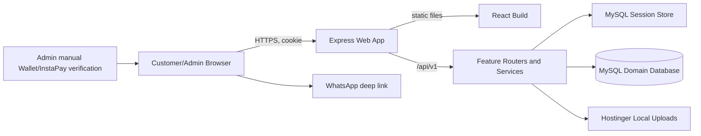

# Architecture

## 1. Architecture Style

A modular monolith is deployed as one Node/Express web application. The React single-page client is built by Vite and served as static files by Express; the same origin exposes `/api/v1`. Feature-first client and server modules share a MySQL database while enforcing table/write ownership through service contracts.

## 2. Component Diagram

## 3. Runtime Flows

1. **Browse:** React requests public catalog/homepage/settings projections; APIs return bounded DTOs without private settings.
2. **Authenticate:** Express verifies a hash, creates a database session, and sets a Secure HttpOnly SameSite cookie. Guards load the actor server-side.
3. **Cart:** authenticated mutations store customer-owned variant rows; responses recalculate current display price and availability.
4. **Checkout/order:** the server locks/reads the cart and variants, rejects removed variants, calculates money, snapshots items, creates order/payment state, and clears the cart in one transaction.
5. **Manual payment:** electronic orders stay `payment-pending`; admin verifies outside the app and records `paid` with timestamp. Cash stays unpaid until delivery.
6. **Pickup:** admin records preparation and delivery. A bounded job cancels only expired unpaid cash orders; paid orders never auto-expire.

## 4. Module Boundaries

FND owns runtime primitives, UI owns reusable presentation, AUTH owns identity/session boundary, CAT owns catalog writes and availability, SET owns configuration, HOME owns merchandising, CART owns cart state, ORD owns checkout/payment/order state, CUS owns admin customer projections, and ADM owns the dashboard. Consumers may not query another feature's tables directly.

## 5. Dependency Rules

- Client: `app → features → shared`; no upward or feature-to-feature imports except exported contract adapters.
- Server: `route → controller → service → repository/platform`.
- Cross-feature server interaction calls an exposed service contract, never a foreign repository.
- Feature manifests let FND compose routes/jobs without parallel edits to registries.
- CAT availability and ORD money/order invariants have one canonical implementation each.

## 6. Data Ownership

AUTH writes Admin, Customer, and Session. CAT writes Product, ProductImage, ProductVariant, Category, and Brand. SET writes StoreSettings. HOME writes HeroSlide, PromotionBanner, and homepage selection tables. CART writes Cart and CartItem. ORD writes Order, OrderItem, order state timestamps, and payment fields. CUS and ADM are read-model consumers and own no duplicate customer/order facts.

## 7. Integration Boundaries

- Browser/server: versioned JSON REST plus multipart image endpoints.
- Local storage: `STO-FND-001` provides validated put/delete/url operations.
- WhatsApp: deterministic `https://wa.me/<normalized-number>` link; no messaging API.
- Wallet EG/InstaPay: display configured numbers; verification is explicitly manual and has no gateway API.

## 8. Security Boundaries

Same-origin cookie sessions, CSRF protection for mutations, origin/CORS restriction, rate limits on authentication, secure password hashing, server-side role/ownership guards, parameterized queries, upload type/size enforcement, non-public secret config, and sanitized errors are mandatory. “No permission system” means no configurable RBAC; it does not remove the fixed customer/admin authorization boundary.

## 9. Failure and Recovery Model

Mutations are idempotent where retries could duplicate orders or state transitions. Transactions roll back order creation completely. Upload compensation deletes newly written files when the owning database write fails. Jobs are safe to rerun. Structured logs include request correlation but exclude passwords, cookies, full payment numbers where unnecessary, and sensitive customer data. Database backups and upload backups are Hostinger operational prerequisites for deployment.

## 10. Architecture Decisions

See `decisions-log.md` for approved decisions DEC-001 through DEC-006. Any move to external object storage, automated payments, multiple services, configurable roles, or a different runtime needs a new approved decision.
