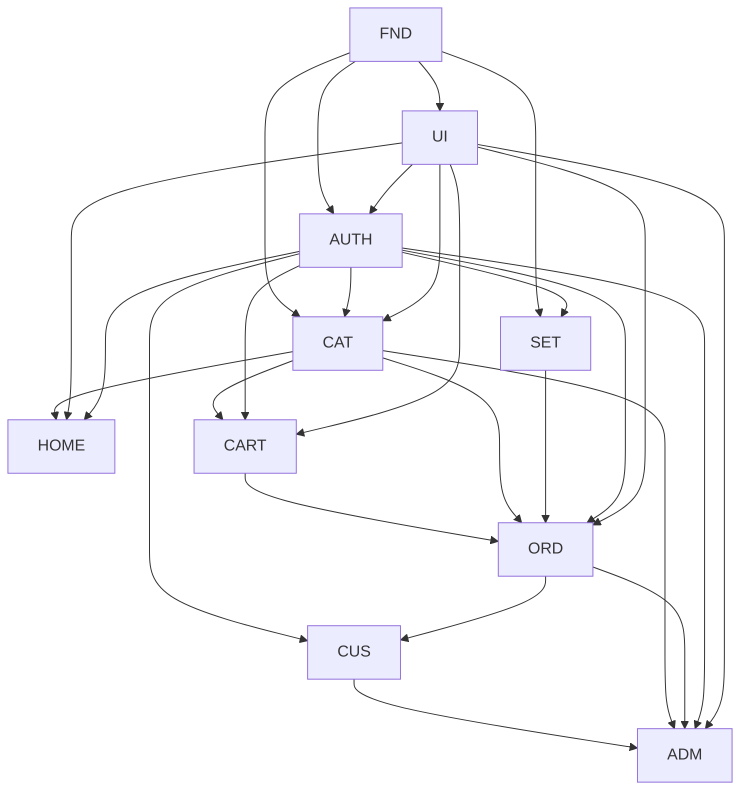

# Dependency Graph

## 1. Feature Graph

## 2. Dependency Registry

| Consumer | Dependency | Contract/Reason | Required Before | Blocking |
|---|---|---|---|---|
| UI | FND | app runtime and HTTP error boundary | UI-001/UI-002 | yes |
| AUTH | FND, UI | DB/HTTP/config and form/state primitives | AUTH-001/AUTH-004 | yes |
| CAT | FND, AUTH, UI | DB/storage/HTTP, admin guard, UI primitives | CAT-001/CAT-003/CAT-004 | yes |
| SET | FND, AUTH, UI | DB/HTTP, admin guard, admin form UI | SET-001/SET-002 | yes |
| HOME | CAT, FND, AUTH, UI | CAT projections/flags, storage, admin guard, UI | HOME-001/HOME-002 | yes |
| CART | AUTH, CAT, FND, UI | customer owner, price/availability, DB/HTTP, UI | CART-001/CART-003 | yes |
| ORD core | CART, CAT, SET, AUTH, FND | locked cart, catalog, payment destination, actors, transaction/job | ORD-002/ORD-003/ORD-006 | yes |
| ORD customer UI | ORD core, UI | quote/create/read APIs and shell | ORD-004/ORD-005 | yes |
| ORD admin UI/job | ORD core, UI, FND | admin actions, layout, job runner | ORD-007/ORD-008 | yes |
| CUS | AUTH, ORD, UI | safe customer and order projections | CUS-001/CUS-002 | yes |
| ADM | AUTH, CAT, ORD, CUS, UI | session/navigation and bounded metrics | ADM-001/ADM-002 | yes |

## 3. Critical Path

`FND-001/002/003 → AUTH-001/002/003/005 → CAT-001/002/006 → CART-001/002 → ORD-001/002/003 → ORD-004/005/006/007/008 → CUS-001/003 → ADM-001/002/003 → release verification`.

## 4. Cycle Check

No implementation dependency cycle remains. HOME changes CAT-owned merchandising flags only through CMD-CAT-001. ORD reads/clears CART through locked contracts while retaining sole Order ownership. CUS/ADM own no duplicate data and consume read projections only.

## 5. Parallel-Safe Groups

- After FND contracts: UI visual work and AUTH core may proceed in separate owned paths.
- After AUTH/UI: CAT core and SET may proceed in separate paths.
- After CAT contracts: HOME and CART may proceed in separate paths; HOME uses CAT command contracts and CART uses CAT read contracts.
- After ORD core merges into its integration branch: WS-ORD-02 customer/checkout UI and WS-ORD-03 admin/job work may run in parallel because their writable paths are disjoint.
- CUS starts after READ-ORD-001 freezes; ADM waits for CUS/CAT/ORD count contracts.
