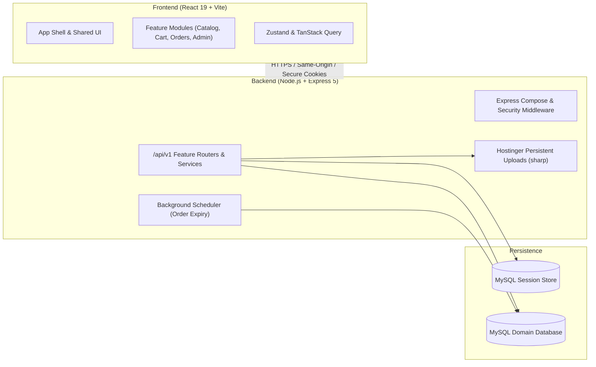

# 🛍️ Press Store

[](https://nodejs.org/)
[](https://react.dev/)
[](https://vitejs.dev/)
[](https://tailwindcss.com/)
[](https://expressjs.com/)
[](https://www.mysql.com/)
[]()

> A production-ready, maintainable clothing e-commerce web platform engineered as a modular monolith. Tailored for streamlined in-store pickup orders, Egyptian payment methods (Cash on Pickup, Wallet EG, InstaPay), and daily catalog and operational management via a dedicated administration dashboard.

---

## 📋 Table of Contents

- [Overview](#-overview)
- [Key Features](#-key-features)
  - [Customer Shopping Experience](#customer-shopping-experience)
  - [Single-Admin Management Hub](#single-admin-management-hub)
  - [Egyptian Payment & Fulfillment Workflows](#egyptian-payment--fulfillment-workflows)
- [Architecture & System Context](#-architecture--system-context)
  - [High-Level Architecture](#high-level-architecture)
  - [Core Principles & Constraints](#core-principles--constraints)
- [Tech Stack](#-tech-stack)
- [Repository Blueprint](#-repository-blueprint)
- [Getting Started](#-getting-started)
  - [Prerequisites](#prerequisites)
  - [Installation](#installation)
  - [Configuration](#configuration)
  - [Database Setup & Migrations](#database-setup--migrations)
  - [Running Locally](#running-locally)
- [Available Scripts](#-available-scripts)
- [Testing & Quality Assurance](#-testing--quality-assurance)
- [Documentation Map](#-documentation-map)

---

## 🌟 Overview

**Press Store** delivers a fast, responsive clothing commerce web application designed to run seamlessly on cost-effective, standard web hosting environments (such as Hostinger web apps) without requiring complex container orchestration, microservices, or external cache clusters.

The system enforces clear domain boundaries, relational data integrity, and strict business rules:
- **Order Model**: Store-pickup fulfillment model with immutable item and price snapshots.
- **Stock Model**: Boolean variant availability (in-stock vs. out-of-stock per color/size) rather than complex warehouse quantities.
- **Payment Verification**: Manual administrative verification for electronic payments (InstaPay and Egyptian Digital Wallets) alongside Cash on Pickup.
- **Unified Deployment**: A single deployable Node/Express service that serves both the Vite-built React SPA and the versioned `/api/v1` REST API.

---

## ✨ Key Features

### Customer Shopping Experience
- **Mobile-First Responsive Interface**: Polished UI with accessible navigation across desktop, tablet, and mobile.
- **Catalog & Discovery**: Browse and filter products by category, brand, and color/size variants, with support for active product discounts.
- **Persistent Cart**: Authenticated carts synced to the MySQL database across browser sessions.
- **Checkout & Pickup**: Seamless pickup order placement with automatic atomic cart conversion and validation against variant availability.
- **Order Tracking & Account**: View personal order history, status progressions, payment details, and item breakdowns.

### Single-Admin Management Hub
- **Single-Admin Authentication**: Isolated and secure administrator credentials and session management.
- **Catalog Management (CRUD)**: Manage categories, brands, products, color/size variants, availability toggles, and discounts.
- **Image Processing**: Upload product and merchandising imagery with automatic validation, stripping of metadata, and normalization via `sharp`.
- **Fulfillment & Order Processing**: Update order statuses (Payment Pending, Processing, Ready for Pickup, Delivered, Cancelled) and record verification timestamps.
- **Direct WhatsApp Outreach**: Standardized deep links using customer phone numbers to streamline fulfillment queries and pickup confirmations.
- **Merchandising & Settings**: Manage homepage hero slides, promotional banners, featured collections, and contact/payment numbers.

### Egyptian Payment & Fulfillment Workflows
- **Cash on Pickup**: Holds items during the approved pickup window; automated cleanup cancels uncollected cash orders upon expiration.
- **Wallet EG (Vodafone Cash, Orange Money, etc.) & InstaPay**: Customer transfers funds directly to the store's configured account numbers; admin verifies transactions manually and records payment confirmations. Paid orders never auto-expire.

---

## 🏗️ Architecture & System Context

Press Store is architected as a **Modular Monolith** with a feature-first internal design on both client and server.

### High-Level Architecture



### Core Principles & Constraints
1. **Hostinger-First**: Deployable as a single Node process; no Docker, VPS-only daemons, Redis, or Elasticsearch required.
2. **Contract Boundaries**: Features interact across boundaries solely through documented service/API contracts, never direct cross-domain table writes.
3. **Robust Security**:
   - Server-side cookie sessions (`HttpOnly`, `Secure`, `SameSite=Lax/Strict`) stored in MySQL.
   - Role boundaries enforcing customer self-isolation and admin privilege checks.
   - Comprehensive CSRF and rate-limiting protections on sensitive endpoints.
4. **Data Immutability**: Order items capture product names, variant descriptors, unit prices, and applied discounts at transaction time.

---

## 🛠️ Tech Stack

| Domain | Technology | Details / Rationale |
|---|---|---|
| **Frontend Framework** | [React 19](https://react.dev/) | Modern concurrent UI layer |
| **Build Tooling** | [Vite 8](https://vitejs.dev/) | High-speed HMR and optimized production bundles |
| **Styling** | [Tailwind CSS v4](https://tailwindcss.com/) | Utility-first modern responsive styling |
| **Client Routing** | [React Router 7](https://reactrouter.com/) | Declarative client-side routing |
| **Server State** | [TanStack React Query](https://tanstack.com/query) | Robust caching, deduping, and background updates |
| **Client State** | [Zustand](https://zustand-demo.pmnd.rs/) | Minimal and lightweight local client state |
| **HTTP Client** | [Axios](https://axios-http.com/) | Normalized HTTP requests with interceptors |
| **Carousels** | [Swiper](https://swiperjs.com/) | Touch-friendly mobile hero banners |
| **Backend Framework** | [Node.js (LTS)](https://nodejs.org/) & [Express 5](https://expressjs.com/) | Lightweight, maintainable REST API server |
| **Database** | [MySQL 8](https://www.mysql.com/) (`mysql2`) | Relational persistence with transactional integrity |
| **Image Processing** | [sharp](https://sharp.pixelplumbing.com/) | Memory-safe resizing, formatting, and EXIF stripping |
| **Testing** | Node Test Runner, Testing Library, Axe-Core | Automated unit, integration, and a11y testing |

---

## 📁 Repository Blueprint

```text
Press Store/
├── AI-DOCS/                         # Specification & architecture source of truth
│   ├── 00-PROJECT/                  # Overviews, stack, architecture, requirements
│   ├── 01-FOUNDATION/               # Coding, API, DB, security, and UI/UX rules
│   ├── 02-FEATURES/                 # Per-feature specs, contracts, and backlogs
│   └── 03-DELIVERY/                 # Workstreams, tracks, runbooks, and build logs
├── public/                          # Static public assets (favicons, etc.)
├── scripts/                         # Database migrations and operational utilities
│   └── migrate.js                   # Sequential SQL migration runner
├── server/
│   └── src/
│       ├── app/                     # Express app creation, middleware pipeline
│       ├── config/                  # Validated environment configuration
│       ├── platform/                # DB pool, session store, storage, HTTP platform
│       ├── features/                # Domain routers, services, repositories, schemas
│       ├── jobs/                    # Periodic tasks (e.g. cash order auto-expiry)
│       └── server.js                # Server entrypoint
├── src/
│   ├── app/                         # App providers, boundaries, route manifest
│   ├── routes/                      # Route composition and guards
│   ├── features/                    # Feature pages, components, hooks, and API adapters
│   │   ├── auth/                    # Customer & Admin authentication
│   │   ├── catalog/                 # Product browsing, filters, search
│   │   ├── homepage/                # Merchandising, hero slides, banners
│   │   ├── cart/                    # Persistent shopping cart
│   │   ├── orders/                  # Checkout, payment review, order tracking
│   │   ├── customers/               # Customer profiles and admin directory
│   │   ├── settings/                # Store phone, payment accounts, policies
│   │   └── admin-dashboard/         # Metrics, recent activity, admin shell
│   ├── shared/                      # Reusable UI primitives, API client, utilities
│   └── main.jsx                     # React DOM entrypoint
├── tests/
│   ├── integration/                 # Integration test suites
│   ├── e2e/                         # Production & release smoke verification
│   └── helpers/                     # Test fixtures and database helpers
├── package.json                     # Root dependencies and scripts
└── vite.config.js                   # Client bundle and local API proxy config
```

---

## 🚀 Getting Started

### Prerequisites

- **Node.js**: `v24.x` (or supported LTS version matching engines `>=24 <25`)
- **npm**: `v10+`
- **MySQL**: `v8.0+` instance running locally or remotely

### Installation

Clone the repository and install all dependencies:

```bash
git clone https://github.com/your-username/press-store.git
cd "Press Store"
npm install
```

### Configuration

Create an environment configuration file in the project root:

```bash
cp .env.example .env
```

Configure your environment parameters:

```env
# Server Configuration
PORT=3000
NODE_ENV=development

# Database Configuration
DB_HOST=127.0.0.1
DB_PORT=3306
DB_USER=press_user
DB_PASSWORD=press_secret
DB_NAME=press_store

# Session & Security
SESSION_SECRET=your-secure-random-session-secret-key-at-least-32-chars

# Storage
UPLOAD_DIR=./uploads
```

### Database Setup & Migrations

Run database migrations to initialize the schema:

```bash
npm run migrate
```

### Running Locally

You can run the full stack concurrently in development mode:

1. **Start the API Server (with watch mode):**
   ```bash
   npm run dev:server
   ```
   *The server starts on `http://localhost:3000` (serving `/api/v1` and health endpoints).*

2. **Start the Vite Client Development Server:**
   ```bash
   npm run dev
   ```
   *The client starts on `http://localhost:5173` with automatic reverse proxying of `/api` requests to port `3000`.*

---

## 📜 Available Scripts

| Command | Description |
|---|---|
| `npm run dev` | Starts the Vite client dev server with instant HMR |
| `npm run dev:server` | Starts the Express server using Node's native `--watch` |
| `npm run build` | Builds the React frontend application into `dist/` |
| `npm run preview` | Locally previews the production client build via Vite |
| `npm start` | Boots the Express server in production mode (serves static `dist/` & API) |
| `npm run migrate` | Executes pending SQL migrations in sequential order |
| `npm test` | Runs the test suite |
| `npm run test:integration` | Runs API and persistence integration test scenarios |
| `npm run test:production` | Builds and verifies the production bundle against the production test runner |
| `npm run lint` | Checks codebase syntax and rules with ESLint |

---

## 🧪 Testing & Quality Assurance

The codebase employs automated and contract-driven verification:
- **Unit & Component Tests**: Component rendering, user interaction, and edge case assertions via `@testing-library/react`.
- **Integration Tests**: Comprehensive database-backed scenarios testing transactional flows (order creation, session lifecycle, image uploads).
- **Accessibility Checks**: Automated WCAG compliance audits using `axe-core`.
- **Linting**: Consistent syntax, hooks rules, and import checks via ESLint 10.

To run all automated verification:

```bash
npm run lint
npm test
npm run test:integration
```

---

## 📚 Documentation Map

The repository's complete implementation specifications, decisions, and track workflows are maintained under `AI-DOCS/`:

- **`AI-DOCS/00-PROJECT/`**: [Project Overview](AI-DOCS/00-PROJECT/project-overview.md), [Architecture](AI-DOCS/00-PROJECT/architecture.md), [Tech Stack](AI-DOCS/00-PROJECT/tech-stack.md), [Source Tree Blueprint](AI-DOCS/00-PROJECT/source-tree-blueprint.md), [Product Scope](AI-DOCS/00-PROJECT/product-scope.md).
- **`AI-DOCS/01-FOUNDATION/`**: [API Rules](AI-DOCS/01-FOUNDATION/api-rules.md), [Database Rules](AI-DOCS/01-FOUNDATION/database-rules.md), [Auth & Security](AI-DOCS/01-FOUNDATION/auth-security-rules.md), [UI/UX Rules](AI-DOCS/01-FOUNDATION/ui-ux-rules.md).
- **`AI-DOCS/02-FEATURES/`**: Specifications, contract IDs, and backlogs for all 10 modular features.
- **`AI-DOCS/03-DELIVERY/`**: [Hostinger Runbook](AI-DOCS/03-DELIVERY/hostinger-runbook.md), [Verification Matrix](AI-DOCS/03-DELIVERY/verification-matrix.md), [Branch Plan](AI-DOCS/03-DELIVERY/branch-plan.md).

---

## 📄 License

This repository and its contents are proprietary and confidential. All rights reserved.
